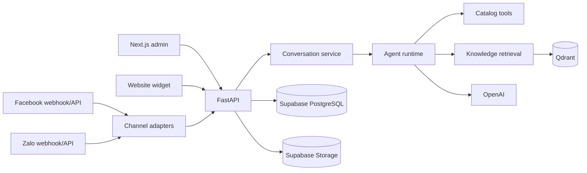

# Architecture

## System shape



FastAPI is the only business/authentication API. Browser code never connects directly to privileged PostgreSQL, Storage, Qdrant or OpenAI resources. Website, Facebook and Zalo enter through different authentication/delivery adapters but converge on the same conversation and agent services.

## Architectural style

The backend is a domain-oriented modular monolith. A domain follows:

```text
router or adapter -> service/use case -> repository/provider
```

- HTTP routers and channel adapters own transport validation.
- Services own authorization, business rules, idempotency and transaction orchestration.
- Repositories own scoped persistence queries and do not commit independently.
- Providers isolate OpenAI, Qdrant, Storage, email and channel vendor SDKs.
- Shared infrastructure belongs in `agent_hub_api.core`; business rules do not.

Do not split into microservices, add Redis or introduce a workflow framework without a measured requirement and an approved task.

## Domain ownership

| Domain | Owns | Must not own |
|---|---|---|
| Identity/workspaces | Credentials, sessions, memberships, roles, tenant context | Business records or channel tokens |
| Agents | Draft/published configuration, allowed tools, catalog/knowledge scope | Provider delivery semantics |
| Knowledge | Sources, versions, chunks, generations and indexing state | Current price or inventory |
| Catalog | Products, variants, options, locations, collections, price and inventory | Model-generated facts |
| Channels | Connections, verified inbound events and outbound delivery | Independent AI reasoning |
| Conversations | Normalized messages, participants, AI/human ownership and workflow state | Raw vendor credentials |
| Contacts | Consented identity links, leads and customer timeline | Authentication identity assumptions |
| Analytics | Derived, tenant-scoped operational measures | Unnecessary raw message or image copies |
| Platform | Plans, entitlements, billing and operator controls | Silent cross-tenant support access |

## Dependency direction

- Channel adapters depend on the conversation application service; conversation services do not import Facebook/Zalo SDK concepts.
- Agent runtime depends on typed catalog/knowledge/tool interfaces rather than transport DTOs.
- Catalog and PostgreSQL remain authoritative for structured commerce facts.
- Qdrant is derived and rebuildable; every retrieval is tenant/source filtered and revalidated against active PostgreSQL state.
- Public rendering uses server-validated product/source evidence, never identifiers parsed from model prose.
- Async ingestion and future outbound delivery persist work before external calls and retry idempotently.

## Tenant boundary

Every tenant-owned record and operation is scoped to a validated `workspace_id`. Dashboard scope comes from authenticated membership. Website scope comes from a short-lived opaque session bound to workspace, agent, published revision and origin. Facebook/Zalo scope comes from a verified channel connection resolved server-side; payload tenant fields are never trusted.

Storage paths, vector payloads, job identities, cache keys, external channel mappings and tool calls carry tenant scope. Public IDs identify resources but do not authorize access.

## Main flows

### Agent response

`validated actor/channel -> normalized message -> conversation -> bounded agent runtime -> catalog/knowledge tools -> validated evidence -> channel renderer -> persisted delivery state`

### Knowledge ingestion

`validated upload/source -> private Storage + durable job -> isolated parse -> versioned chunks -> batched embeddings -> Qdrant index -> atomic active generation`

### Social inbound

`verified webhook -> connection lookup -> event dedupe -> normalized persisted message -> AI or assigned human workflow -> durable outbound attempt -> provider delivery state`

## Contract ownership

- Logical entities and invariants: [`reference/data-model.md`](reference/data-model.md)
- HTTP/SSE/webhook contracts: [`reference/api.md`](reference/api.md)
- Agent and retrieval mechanics: [`reference/agent-runtime.md`](reference/agent-runtime.md)
- Channel normalization/delivery: [`reference/channels.md`](reference/channels.md)
- Frontend boundaries: [`reference/frontend.md`](reference/frontend.md)
- Security invariants: [`security.md`](security.md)
