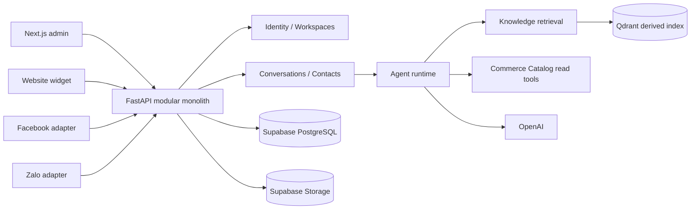

# Architecture

Load this authority only when a phase changes module ownership, dependency direction, runtime composition, source of truth or an external-system boundary. Routine domain work should not preload it.

## Current system topology



FastAPI is the only business/authentication API. Browser, widget and channel code never connects directly to privileged PostgreSQL, Storage, Qdrant or model resources. Website, Facebook and Zalo have different authentication/delivery adapters but converge on the same Agent and Conversation systems.

## Architectural style

The backend is a domain-oriented modular monolith:

```text
router or external adapter
  -> service / use case
    -> repository or provider
```

- Routers/adapters validate transport input and external authenticity.
- Services own authorization, business rules, idempotency and transactions.
- Repositories own scoped persistence queries and do not commit independently.
- Providers isolate OpenAI, Qdrant, Storage, email and channel vendors.
- `core` contains shared infrastructure, not business rules.

Use direct in-process service calls and one transaction where appropriate. Do not split domains into microservices or add distributed infrastructure without a measured requirement and approved task.

## Platform/Core and domain capabilities

Conceptually:

```text
Platform/Core
├── Workspace / tenancy
├── Identity / membership
├── Agents and published revisions
├── Knowledge
├── Conversations and Channels
├── Permissions
├── Tool execution boundaries
└── Audit / observability foundations

Optional domain capabilities
├── Commerce (implemented Catalog; broader operations planned)
├── CRM / Booking / Forms / Email / Calendar / Documents
└── future approved domains
```

This is a responsibility and dependency model, not a required folder/table layout. Platform/Core must function without Commerce. A domain may depend on platform tenancy, Agent tool contracts or Conversation context; generic platform behavior must not require that domain's records.

### Current ownership

| Domain | Owns now | Must not own |
|---|---|---|
| Identity/Workspaces | credentials, sessions, memberships, roles, tenant context | business/domain records |
| Agents | draft configuration, lifecycle, Catalog/Knowledge assignments, published revisions | authoritative domain data or provider delivery |
| Knowledge | bases, sources, versions, chunks, generations, indexing state | current price/inventory/order/payment state |
| Commerce Catalog | products, variants, options, collections, locations, current price/inventory | model-generated facts |
| Channels | connections, verified events, external mappings, outbound delivery | independent agent reasoning |
| Conversations | normalized messages, workflow, AI/human handling, inbox state | raw credentials or domain records |
| Contacts | consented/channel identity relationships and timeline | authentication identity or Commerce customer lifecycle |
| Analytics | derived tenant-scoped operational measures | unnecessary raw content/PII copies |
| Platform billing | usage foundations; future plans/entitlements/subscriptions | merchant/customer payment custody |

## Source-of-truth matrix

| System | Authority |
|---|---|
| PostgreSQL | Workspace, Agent, Knowledge text/metadata/chunks, Conversation, Contact, Commerce and future relational domain state |
| Supabase Storage | Uploaded object bytes subject to PostgreSQL authorization/lifecycle metadata |
| Qdrant | Derived vector index only; filtered, revalidated and rebuildable |
| LLM/OpenAI | Bounded reasoning/generation/embedding runtime; never authoritative persistence |
| External channel/payment providers | Provider-owned external delivery/payment state where their verified contract says so |

Do not duplicate authoritative mutable domain state in agent configuration, prompts, response prose or Qdrant.

## Workspace tenancy boundary

Every tenant-owned row and operation is scoped to validated `workspace_id`. Dashboard scope comes from current authenticated membership. Website scope comes from an opaque origin-bound session tied to workspace, agent and revision. Social scope comes from a verified server-owned connection; provider payload tenant fields are never trusted.

Storage paths, vector payloads, jobs, external mappings and tools carry tenant scope. Public IDs identify resources but do not authorize access. Cross-domain references use tenant-safe composite relationships or equivalent transactional validation.

## Agent runtime boundary

### Current

The runtime resolves one Agent's Catalog scope and assigned Knowledge, retrieves permitted Knowledge, calls OpenAI through a provider adapter and validates final product/source evidence. It exposes the fixed read-only Catalog tools and Catalog-specific policy only when the server-authorized scope contains readable products. Published Channel execution uses an immutable Agent revision and revalidates current resource availability.

The base prompt and new Agent defaults are domain-neutral. Knowledge-only publication and execution require no Commerce records and cannot produce product cards. This capability-aware conditional remains deliberately concrete; the runtime is not a general tool-composition system.

### Approved direction

```text
validated actor/channel
  -> Agent + immutable revision
    -> authorized typed Tool / Action
      -> independent authorization and policy check
        -> owning Domain Service
          -> authoritative domain state
```

Model arguments are untrusted. The server injects workspace and permission scope. Domain services enforce business rules and transactions. The first effectful tool—not documentation alone—triggers the smallest implementation of per-Agent/revision authorization, execution audit, side-effect classification, approval policy and idempotency required by that use case.

Tool identifiers should be stable and namespaced when composition becomes real, for example `knowledge.search`, `commerce.catalog.search` or `booking.reservation.create`. These names illustrate direction; they do not register or implement future tools.

Do not introduce a universal registry, plugin framework or workflow engine before a concrete feature needs it.

## Knowledge/RAG boundary

```text
validated source
  -> private Storage / PostgreSQL version
    -> durable bounded ingestion
      -> authoritative PostgreSQL chunks
        -> embeddings and Qdrant points
          -> tenant/source-filtered search
            -> PostgreSQL active-generation revalidation
```

Knowledge is domain-independent and supports profiles, CV/project content, policies, manuals and internal documents. Retrieved content is untrusted data. Structured changing facts—price, inventory, order and payment state—remain in their owning services and are read through typed tools.

## Channels and conversations

Adapters verify/normalize provider events and render supported output; they do not implement separate Agent architectures. Verified inbound work is persisted and deduplicated before model work. Outbound work is persisted before external delivery, claimed with leases/fencing and retried only when provider semantics make retry safe.

The normalized Conversation model remains generic even when one response contains optional domain rendering such as Commerce product cards. Future project links or other domain evidence should be additive channel-rendering concerns, not mandatory Conversation fields for every use case.

## External and regulated integrations

Credentials remain server-side behind providers/vaults. AgentHub integrates with licensed payment, invoicing, signature/trust and other regulated providers where applicable. Verified external events update AgentHub records through domain services. Provider UI affordances never imply that AgentHub itself is a wallet, custodian, lender, trust provider or regulated intermediary.

## Audit, approval and compliance direction

Current domain audit exists for Conversation and Contact workflow transitions; usage and delivery facts are persisted. There is no general tool-execution audit table or general `audit_logs` table today.

Future effectful actions must be attributable to agent revision, actor/conversation and tool identifier; expose status/timestamps and safe redacted references; and support explicit human approval for high-impact actions. Model/version traceability, AI disclosure and risk classification are added only when a concrete product/legal requirement needs them.

## Evolution rules

- Prefer additive capabilities and minimum boundary improvements over rewrites.
- Preserve stable tables, routes and identifiers when names are merely historical.
- Add abstractions only for a present second use case or a concrete safety boundary.
- Keep domain mutations in domain services and transactions.
- Build one approved vertical slice at a time; do not prebuild future domains.
- Maintain compatibility with Portfolio, Commerce and Internal Assistant scenarios from [`product.md`](product.md).
- API contracts belong in [`api.md`](api.md); schema in [`data-model.md`](data-model.md); durable decisions in [`decisions.md`](decisions.md).
