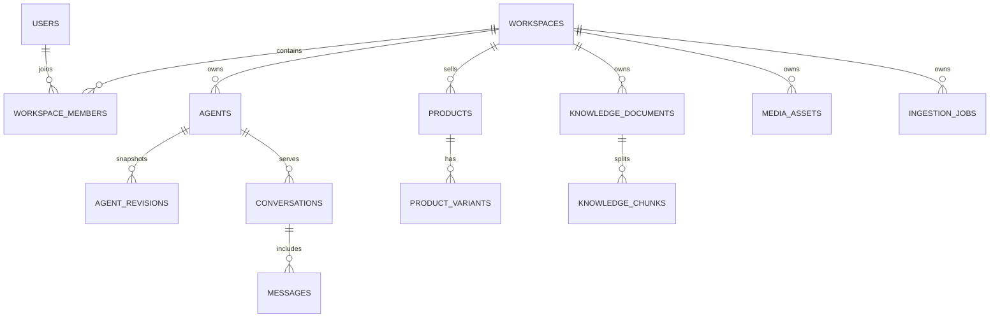

# Relational model details — workspace/agent canonical schema

Detailed implementation companion to `../04-data-model.md`; if a table is missing in the partial SQL reference, it is NOT removed from the master domain scope. IDs follow `identifiers.md`.

## Domain model

## Core columns and invariants
- `users`: UUIDv7 id, email normalized/citext unique, password_hash Argon2id, status/timestamps; never store plaintext password.
- `workspaces`: UUIDv7 id, slug unique, display_name, timezone default `Asia/Ho_Chi_Minh`, owner established via membership; do not use slug as authorization.
- `workspace_members`: BIGINT id, workspace_id/user_id, role `owner`/`admin`/`member`, composite unique. Owners and admins may update workspace settings; members have read access. Ownership transfer/audit remains future work.
- `agents`: BIGINT id, UUIDv7 public_id, workspace_id, name, draft_config jsonb, published_revision_id nullable, state; publish only if config and knowledge validate.
- `agent_revisions`: BIGINT id, agent_id, revision_no unique per bot, immutable config jsonb, published_at; immutable published snapshot.
- `products`: BIGINT id, workspace_id, SKU optional, name, description, category, price_minor nullable, currency, url, status; variants have product_id, sku, size/color, stock nullable. `NULL` stock is **unknown**, not zero or unlimited.
- `knowledge_documents`: BIGINT id, workspace_id, storage asset id, title, kind, status, content_sha256, error; chunks have workspace_id denormalized with constraints/service checks, document_id, position, content, embedding vector if configured; selected source relations/revision manifests avoid cross-bot leakage.
- `conversations`: BIGINT id + UUIDv7 public_id, workspace_id, agent_id, channel, revision_id, anonymous_session_hash, state/timestamps; visitor identity optional. `messages`: BIGINT id, conversation_id, role, text, attachments metadata, status, generation/source metadata (JSONB), sequence/created_at.
- `media_assets`: BIGINT id, workspace_id, bucket, object_key, MIME, bytes, sha256, visibility/retention. `ingestion_jobs`: BIGINT id, workspace_id, document_id, status, attempt, lease, error/timestamps.
- `auth_sessions`: BIGINT id, user_id, `refresh_token_hash`, family id, expiry, revoke/rotated status; refresh tokens random. `audit_logs`: BIGINT id, workspace_id nullable, actor_user_id, event name, target reference, safe metadata, created_at.

## Constraints and query patterns
Every mutable shop resource has immutable `workspace_id` and indexed tenant predicates. Cross-table shop consistency must be checked by service/DB constraints; avoid binding a bot of shop A to a doc of shop B. No hard-delete cascade that unintentionally destroys auditable conversations; archive/deletion policy first. One user cannot have duplicate membership for a shop; SKU unique per shop where not null; revision_no unique per bot. Monetary amounts use integer **minor units**; currency explicit. `created_at` and `updated_at` as UTC timestamptz, display local time only.

## Vector strategy
Choose a specific OpenAI embedding model and its actual dimension at implementation; configure schema accordingly and record it. Do **not** paste a made-up `vector(1536)` without model/dimension validation. For small F3 dataset exact similarity search with mandatory shop filter may be adequate; build HNSW/IVFFlat only after measuring and understanding tenant-filter effects. Content search and structured product query should be distinct functions.

## SQL reference
See `sql/001_reference_schema.sql`: intentionally limited **reference DDL** showing critical relations and ID behavior; complete Alembic migrations must implement fields, indexes, partial unique rules, enum/constraints, RLS policy where used, data retention and tests before treating database as production-ready.
