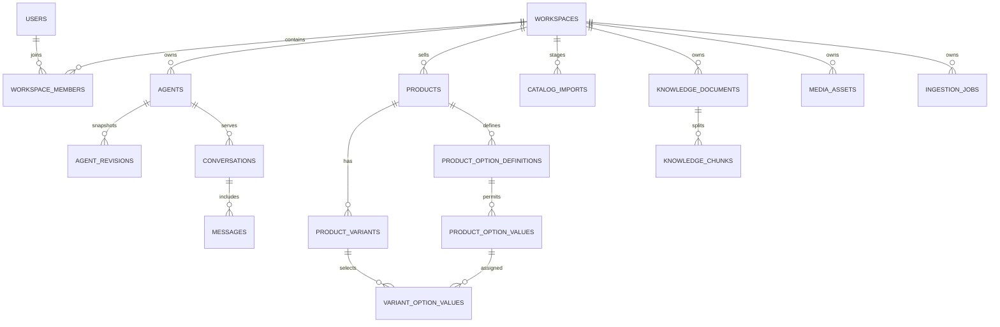

# Relational model details — workspace/agent canonical schema

Detailed implementation companion to `../04-data-model.md`; if a table is missing in the partial SQL reference, it is NOT removed from the master domain scope. IDs follow `identifiers.md`.

## Domain model

## Core columns and invariants
- `users`: UUIDv7 id, email normalized/citext unique, password_hash Argon2id, status/timestamps; never store plaintext password.
- `workspaces`: UUIDv7 id, slug unique, display_name, timezone default `Asia/Ho_Chi_Minh`, owner established via membership; do not use slug as authorization.
- `workspace_members`: BIGINT id, workspace_id/user_id, role `owner`/`admin`/`member`, composite unique. Owners and admins may update workspace settings; members have read access. Ownership transfer/audit remains future work.
- `agents`: BIGINT id, UUIDv7 public_id, workspace_id, name/greeting/safe instructions/locale, state, explicit all-location/all-collection flags and soft archive. `public_id` is globally unique; `(workspace_id,id)` supports tenant-safe child FKs. F3.1 stores selected locations and collections in composite workspace-scoped join tables; provider config and published revisions remain later F3 work.
- `agent_revisions`: BIGINT id, agent_id, revision_no unique per bot, immutable config jsonb, published_at; immutable published snapshot.
- `products`: BIGINT id, workspace_id, optional workspace-unique product SKU, name, description, category/brand, exact decimal base price nullable, currency, URL and status. Variants have product_id, optional workspace-unique variant SKU, name, exact decimal price override, nullable stock, inventory policy, deterministic option signature, status and legacy size/color projections. `NULL` stock is **unknown**, not zero or unlimited; zero is a known quantity. Archived product and variant SKU values remain reserved.
- `product_option_definitions`, `product_option_values` and `variant_option_values`: normalized generic variant dimensions, ordered values and assignments. They are the source of truth for options. Constraints prevent a variant from selecting two values for one definition; search with multiple options correlates every constraint to the same variant.
- Product/variant attributes store non-identity facts without moving core identity, price, stock or option relationships into JSONB. `catalog_external_refs` maps trusted source namespaces and IDs to canonical entities; product names never act as identity.
- Product images may point to a managed Storage object or a recorded remote reference with explicit source/lifecycle metadata. Import analyze/commit never fetches arbitrary remote URLs.
- `catalog_imports` owns normalized staged records, issues and structural mapping-profile evidence. Analyze is read-only with respect to canonical catalog rows; commit revalidates affected identity evidence and applies an atomic idempotent MERGE. Records absent from an input file are untouched.
- `knowledge_bases` and `agent_knowledge_bases`: workspace-owned source groupings and composite tenant-safe agent assignments. A base records active and optional target embedding profiles during a migration.
- `knowledge_documents` and immutable `knowledge_document_versions`: BIGINT identity, workspace/base ownership, logical title/kind/status and either manual text or one private media asset. `knowledge_generations` bind one version to one immutable embedding profile and record chunker version/parameters/pipeline hash plus building/ready/failed/revoked state. A separate mapping selects at most one active generation per document.
- `knowledge_chunks`: denormalized workspace and generation identity, deterministic position, authoritative normalized text, content hash, source locator and metadata. Composite constraints prevent same-workspace cross-document version/generation substitution, not only cross-tenant linkage.
- `embedding_profiles`: immutable provider/model/dimensions/provider-revision/pipeline-version/distance/Qdrant-collection/config-hash records with build/active/deprecated/failed state. `knowledge_chunk_embeddings` maps workspace/chunk/profile to stable Qdrant point ID, content hash, index status and timestamp; vector values live only in Qdrant.
- `conversations`: BIGINT id + UUIDv7 public_id, workspace_id, agent_id, channel, revision_id, anonymous_session_hash, state/timestamps; visitor identity optional. `messages`: BIGINT id, conversation_id, role, text, attachments metadata, status, generation/source metadata (JSONB), sequence/created_at.
- `leads`: BIGINT id with immutable composite workspace links to conversation, widget session and agent; at most one per conversation. Stores only explicitly consented optional name plus normalized email and/or validated phone, consent timestamp/version, request hash and session-scoped idempotency key, `new | contacted | closed` follow-up state and local-pilot retention deadline. Public creation never accepts workspace/agent/session IDs.
- `media_assets`: BIGINT id, workspace_id, bucket, server-generated object key, MIME, bytes, sha256, private visibility and cleanup state. `ingestion_jobs`/attempts bind workspace, document, version and target generation with idempotency evidence, status, safe error, schedule, attempt, expiring lease, heartbeat and fencing token/version. A partial unique index allows only one active job per document.
- `auth_sessions`: BIGINT id, user_id, `refresh_token_hash`, family id, expiry, revoke/rotated status; refresh tokens random. `audit_logs`: BIGINT id, workspace_id nullable, actor_user_id, event name, target reference, safe metadata, created_at.

## Constraints and query patterns
Every mutable shop resource has immutable `workspace_id` and indexed tenant predicates. Cross-table shop consistency must be checked by service/DB constraints; avoid binding a bot of shop A to a doc, import issue, option value or product of shop B. No hard-delete cascade that unintentionally destroys auditable conversations; archive/deletion policy first. One user cannot have duplicate membership for a shop; SKU unique per shop where not null; trusted external identity unique in its workspace/source namespace; revision_no unique per bot. Catalog monetary amounts use `NUMERIC(18,2)` and application `Decimal`, with explicit currency and decimal-string API serialization. `created_at` and `updated_at` are UTC timestamptz, displayed in local time only.

## Vector strategy
Qdrant is a rebuildable index, not the canonical chunk store. Choose and record an immutable embedding profile rather than hardcoding an OpenAI-specific column: provider, model, actual dimensions, optional provider revision, AgentHub pipeline version, distance metric and collection. One collection is shared across tenants per profile; `workspace_id` is a tenant-indexed payload field and every query also filters allowed sources. Results are revalidated against the active ready Postgres generation.

Changing provider/model/dimension/pipeline creates a new profile and collection. Backfill and validate it before atomically switching the active profile; retain the old profile temporarily for rollback. Content search and structured product query remain distinct functions.

## SQL reference
See `sql/001_reference_schema.sql`: intentionally limited **reference DDL** showing critical relations and ID behavior; complete Alembic migrations must implement fields, indexes, partial unique rules, enum/constraints, RLS policy where used, data retention and tests before treating database as production-ready.
