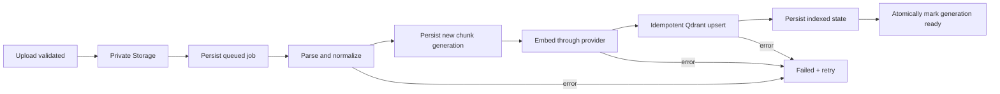

# Storage, image safety and ingestion

## Supabase Storage policy
Buckets: `agent-hub-private` for customer/shop uploads & source documents (private); `agent-hub-public` only for intentionally published logos/product imagery (public). Example private object key: `workspaces/<shop_uuidv7>/knowledge/<document_bigint>/<random-name>.pdf`; do not trust uploaded filename as path. Store metadata in DB; object key is server-generated. Backend uses server-only key or restricted storage credentials after checking tenancy. Private file download via short-lived signed URL *after auth* or authenticated API proxy, never permanent public link.

## Upload validation
Initial knowledge limits are 10 MiB per document, 100 documents and 100 MiB stored source data per workspace, 10 uploads per rolling 10 minutes, 200 PDF pages, 1,000,000 extracted characters, 1,000 chunks per generation and 20,000 retained chunks per workspace. Uploads stream through a bounded 64 KiB buffer and reject overflow before Storage upload. Accepted knowledge formats are strict UTF-8 TXT and PDF after declared MIME plus signature validation; Markdown, DOCX, archives, executable formats and arbitrary remote URL fetches are not accepted. Product/chat image limits remain separate. Requirements can evolve via ADR.

PDF decoding is hostile-input work. It runs outside the API/worker process in an isolated child using strict `pypdf==6.19.0`, a 30-second wall timeout, 20 CPU seconds, 512 MiB memory and 4 MiB result cap. POSIX uses process resource limits and Windows uses a Job Object; failure to install limits fails closed. Encrypted PDFs return `PDF_ENCRYPTED_UNSUPPORTED`, scan/image-only PDFs return `PDF_TEXT_NOT_FOUND`, and OCR is outside current scope. Malware scanning remains a launch decision before accepting uploads from untrusted public users; dashboard uploads are private and still parsed in isolation.

## Document lifecycle

Persist the job **before** async processing and atomically link workspace, document, immutable version and generation. The dedicated worker polls PostgreSQL and claims with `FOR UPDATE SKIP LOCKED`; a 120-second lease is renewed every 30 seconds, every state-changing write checks its lease token/version, and takeover increments the fencing version. At most one active job exists per document and two leased jobs run concurrently per workspace. The maximum is five attempts; transient failures use capped exponential full-jitter delays from 5 to 900 seconds. Permanent content/configuration failures do not auto-retry.

Persist authoritative chunks before external embedding/index calls. Qdrant point IDs are deterministic from generation/chunk identity and payload includes workspace, knowledge base, document/version, generation, chunk, profile and content hash. A Qdrant success followed by DB failure is idempotently retried; the reconciler removes points belonging to failed/revoked generations and stale Storage reservations. Transactional cutover rechecks document/base state and fencing, so a deleted document or archived base cannot be resurrected. F3.3 adds the concrete OpenAI/Qdrant adapters and retrieval revalidation; F3.2 unit tests use fakes and must not require external providers.

## Retention and deletion
Document deletion revokes the active generation and cancels active jobs in the same transaction, then asynchronously cleans Qdrant points and Storage objects. Source/generation rows remain as lifecycle evidence until an approved retention purge; the production retention interval is still an open deployment decision. Archiving a knowledge base prevents new ingestion/cutover but does not delete conversations. User-uploaded chat image retention policy must be disclosed and implemented, with scheduled expiry cleanup and documented backup behavior. Signed URLs expire; warn that a previously issued signed URL may remain valid until expiry.
