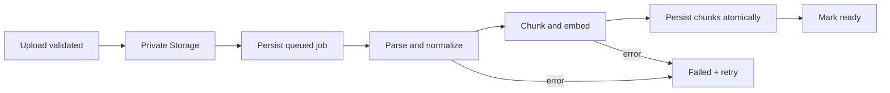

# Storage, image safety and ingestion

## Supabase Storage policy
Buckets: `agent-hub-private` for customer/shop uploads & source documents (private); `agent-hub-public` only for intentionally published logos/product imagery (public). Example private object key: `workspaces/<shop_uuidv7>/knowledge/<document_bigint>/<random-name>.pdf`; do not trust uploaded filename as path. Store metadata in DB; object key is server-generated. Backend uses server-only key or restricted storage credentials after checking tenancy. Private file download via short-lived signed URL *after auth* or authenticated API proxy, never permanent public link.

## Upload validation
Set explicit initial limits in config, e.g. 10 MB documents, 5 MB customer image, 1 image per chat turn, allowed `pdf`, `txt`, `md`, and `png/jpeg/webp` for pictures; requirements can evolve via ADR. Validate declared MIME AND magic bytes, actual decoded image dimensions/pixel count, filename length, content hash. Reject SVG, executable, archive, zip bombs and remote URL-fetch of user arbitrary URLs. Normalize EXIF orientation, strip EXIF metadata from photo used by model, never expose public Storage path for private visitor images. Consider malware scanning before production exposure of user-uploaded documents.

## Document lifecycle

Persist job **before** async processing and atomically link document. A simple local runner may poll Postgres and claim jobs with `FOR UPDATE SKIP LOCKED`, lease expiry and max attempts. Import pipeline is idempotent by document hash/version; use transactional swap/new generation to prevent partially indexed docs from being retrievable. PDF text extraction should not assume OCR; if scanned image-only, clearly mark extraction insufficient until OCR added. Never embed binary PDF raw into prompt.

## Retention and deletion
Document deletion revokes `ready` status immediately then asynchronously cleans chunks/object; archive bot does not auto-delete conversations. User-uploaded chat image retention policy must be disclosed and implemented (example configurable 30 days), with scheduled expiry cleanup; backups/retention rules documented at deployment. Signed URLs expire; warn that a previously issued signed URL may remain valid until its expiry.
