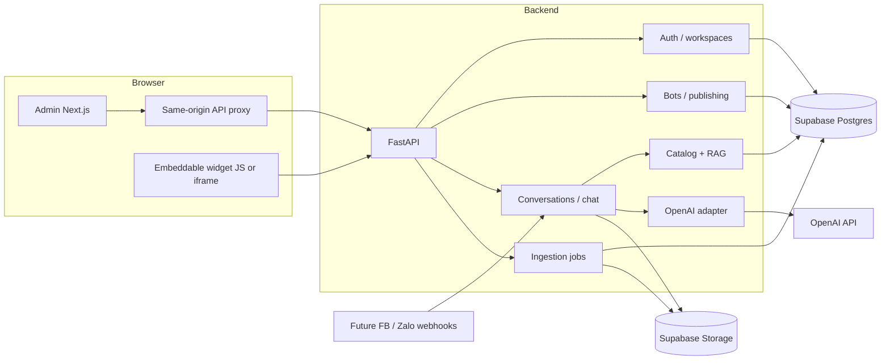

# System context and module boundaries



## Backend packages

Current F1 implementation:

```text
apps/api/
  src/agent_hub_api/
    main.py
    models.py                 # central ORM registry for Alembic
    health.py
    core/                     # shared infrastructure only
      config.py
      database.py
      errors.py
      identifiers.py
    identity/
      models.py
      schemas.py
      repository.py
      service.py
      router.py
      dependencies.py
      security.py
      email_delivery.py
    workspaces/
      models.py
      schemas.py
      repository.py
      service.py
      router.py
  migrations/
  tests/
```

Each domain follows `router -> service -> repository`: routers own HTTP concerns, services own
business rules, authorization and transaction boundaries, and repositories own ORM queries without
committing. `identity` does not depend on `workspaces`; workspace profile composition is owned by
the workspace module. Future domains such as catalog, knowledge and conversations are added only
when their approved phase requires them, following the same dependency direction.

## Frontend packages

Current F1 implementation:

```text
apps/web/src/
  app/                       # routes, layout and Next.js conventions
  features/
    auth/
    workspaces/
  components/                # shared UI
  lib/                       # shared API client and utilities
apps/widget/                  # independent widget package
```

Do not pre-create feature folders for later phases. The widget remains independent and must not
import the dashboard feature tree.

## Boundaries and failures
- OpenAI/network failure does not corrupt conversation; store failed status and allow retry.
- Database failure returns typed 503; no sample result fallback.
- Long document parsing is a persisted job, not a long request.
- Embed script must load asynchronously and isolate CSS; failure must not break customer storefront.
- AI output is untrusted content; server validates structured identifiers and controls which product/source cards can be returned.
