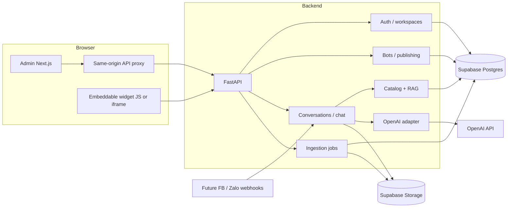

# System context and module boundaries



## Backend packages (illustrative)
```text
app/
  main.py; core/{config,db,security,ids,errors}.py
  api/v1/{auth,workspaces,agents,products,knowledge,conversations,chat,widget}.py
  domain/{auth,workspaces,agents,catalog,knowledge,chat,channels}/
  services/{retrieval,model_client,media,storage,publication}/
  repositories/{users,workspaces,agents,products,documents,conversations}/
  jobs/{runner,ingest_document,cleanup_assets}/
  schemas/; models/; tests/
alembic/versions/
```

## Frontend packages (illustrative)
```text
src/app/{(auth),app/[shopSlug],widget-preview}/
src/components/{ui,layout,dashboard,agents,chat,products,knowledge,widget}/
src/features/{auth,workspaces,agents,conversations,products,knowledge}/
src/lib/{api,query,format,auth}; src/styles/
```

## Boundaries and failures
- OpenAI/network failure does not corrupt conversation; store failed status and allow retry.
- Database failure returns typed 503; no sample result fallback.
- Long document parsing is a persisted job, not a long request.
- Embed script must load asynchronously and isolate CSS; failure must not break customer storefront.
- AI output is untrusted content; server validates structured identifiers and controls which product/source cards can be returned.
