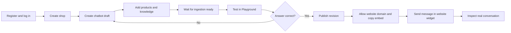

# User journeys and state model

## Journey A — first shop to live bot

Each step gives completion/next-step guidance; never say a bot is live until publish completed and embedded page actually loads. Knowledge upload state must finish before retrieval.

## Journey B — customer product discovery
Customer opens launcher → reads AI disclosure/greeting → asks e.g. `Có váy mùa hè size M không?` → server scopes current published bot to shop → search available matching catalog, optionally relevant size guides → stream answer → render 0–N real structured product cards with product URL → customer visits merchant storefront. If there are no matching products, assistant explicitly says none found; no fabricated price/stock.

## Journey C — image-based discovery
Click image button → select local image → client shows thumbnail and progress → server validates MIME/signature/size → store privately under shop-scoped path, short-lived model access → response makes appropriately qualified visual observations → optional catalog match → cleanup/retention per docs. Image-only message is valid if chosen model supports it; reject non-image files before OpenAI call.

## Journey D — edit/publish
Open published bot → edit draft → `Có thay đổi chưa lưu` warning → save draft → playground tests draft → publish snapshots config + allowed ready knowledge references atomically → public widget begins using published revision; existing conversation can pin old revision until restart, never half-new config in same turn.

## Async finite states
| Domain | State(s) | Transition constraints |
|---|---|---|
| document | queued, processing, ready, failed | only `ready` searchable; delete revokes immediately |
| bot | draft, published, archived | archived cannot start new sessions; published changes via revision |
| message | pending, streaming, completed, failed, canceled | never retry with duplicate message ID; idempotency key per send |
| channel | disconnected, connected, error | connected only after actual provider check |
| browser | loading, ready, empty, error, forbidden | error has retry, forbidden cannot leak resource metadata |

## Standard microcopy (`vi-VN`)
`Chưa có chatbot. Tạo chatbot đầu tiên để bắt đầu.` / `Đang tải dữ liệu…` / `Không thể tải dữ liệu. Thử lại.` / `Tài liệu đang được xử lý.` / `Chưa tìm thấy sản phẩm phù hợp.` / `Phản hồi bị gián đoạn. Thử lại.` / `Chức năng này chưa được bật.` These are approved defaults, adapt to real resource status.
